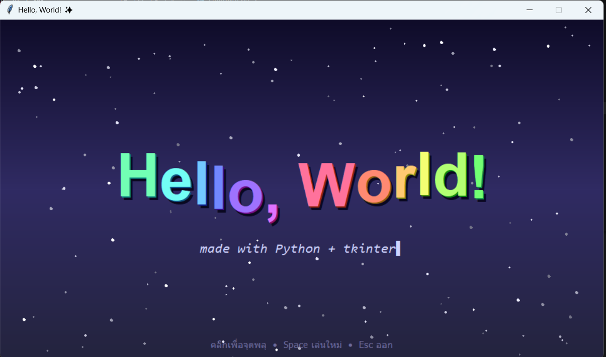

# ✨ Hello, World! Animation (tkinter)

โปรแกรม Hello World แบบมีแอนิเมชัน เขียนด้วย Python + tkinter ในไฟล์เดียว ไม่ต้องติดตั้งไลบรารีเพิ่ม



## 🎨 ฟีเจอร์

- **ตัวอักษรตกแบบเด้ง** – "Hello, World!" ตกลงมาทีละตัวแบบเด้ง (bounce) และมีประกายไฟเล็กๆ ตอนแต่ละตัวลงถึงพื้น
- **คลื่นสีรุ้ง** – เมื่อลงครบแล้ว ตัวอักษรจะลอยขึ้นลงเป็นคลื่น สีไล่เป็นสีรุ้งไปเรื่อยๆ มีเงาและเส้นขอบเรือง
- **ข้อความพิมพ์ทีละตัว** – คำบรรยาย "made with Python + tkinter" ค่อยๆ พิมพ์ขึ้นมาพร้อมเคอร์เซอร์กระพริบ
- **ท้องฟ้ายามค่ำคืน** – พื้นหลังไล่สีโทนม่วง มีดาวกระพริบ 140 ดวง
- **ดาวตก** – มีดาวตกพาดผ่านจอแบบสุ่ม
- **พลุอัตโนมัติ** – พลุขึ้นเองทุก 1.5–3 วินาที อนุภาคมีแรงโน้มถ่วงและค่อยๆ จางหายไป

## 🎮 การควบคุม

| การกระทำ | ผลลัพธ์ |
|---|---|
| 🖱️ **คลิกซ้าย** ตรงไหนก็ได้บนหน้าต่าง | จุดพลุตรงตำแหน่งที่คลิก (คลิกรัวๆ ได้) |
| ⌨️ **Space** | เล่นแอนิเมชันใหม่ตั้งแต่ต้น |
| ⌨️ **Esc** | ปิดโปรแกรม |

## 🚀 วิธีรัน

### 1. สิ่งที่ต้องมี
- Python 3.8 ขึ้นไป
- tkinter (ปกติติดมากับ Python บน Windows และ macOS อยู่แล้ว)

ตรวจสอบว่ามี tkinter หรือไม่:

```bash
python -m tkinter
```

ถ้ามีหน้าต่างเล็กๆ เด้งขึ้นมา แปลว่าใช้ได้

### 2. ติดตั้ง tkinter (กรณีที่ยังไม่มี)

| ระบบปฏิบัติการ | คำสั่ง |
|---|---|
| Ubuntu / Debian | `sudo apt install python3-tk` |
| Fedora | `sudo dnf install python3-tkinter` |
| Arch | `sudo pacman -S tk` |
| macOS (Homebrew) | `brew install python-tk` |
| Windows | ติดตั้ง Python จาก [python.org](https://www.python.org/downloads/) แล้วติ๊ก **tcl/tk and IDLE** ตอนติดตั้ง |

### 3. รันโปรแกรม

```bash
python hellogui.py
```

> บน macOS / Linux บางเครื่องอาจต้องใช้ `python3` แทน `python`

## ⚙️ ปรับแต่ง

แก้ค่าด้านบนของไฟล์ `hellogui.py` ได้เลย:

```python
W, H = 960, 540                        # ขนาดหน้าต่าง
FRAME_MS = 16                          # ระยะเวลาต่อเฟรม (16ms ≈ 60 FPS)
TEXT = "Hello, World!"                 # ข้อความหลัก
SUBTITLE = "made with Python + tkinter"  # ข้อความบรรยาย
```

## 📁 โครงสร้างไฟล์

```
.
├── hellogui.py   # โค้ดโปรแกรม
├── hello.py   # โค้ดโปรแกรม hello test
├── Screenshot.png             # ภาพตัวอย่าง
└── README.md
```